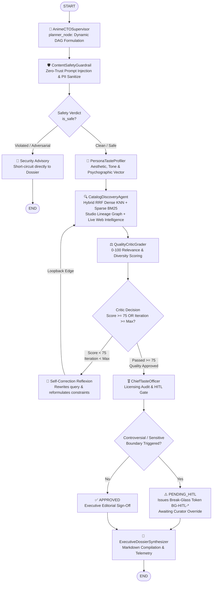

# 🧠 Enterprise Deep Multi-Agent Mesh & CTO Governance

Inspired by **AIE5 Phase 7 Agentic RAG** (`32_Agentic_RAG_Project`) and **AI_Security_Production_App**, the Hybrid Anime Recommender platform features an **Industrial-Grade Deep Multi-Agent Mesh** built on LangGraph StateGraphs, memory checkpointer persistence, self-correcting reflection loops, and Chief Taste Officer (CTO) Human-in-the-Loop governance.

---

## 1. Multi-Agent Topology & State Machine



---

## 2. Specialized Multi-Agent Roles

| Node Name | Component Class | Core Responsibilities |
|---|---|---|
| **👑 AnimeCTOSupervisor** | `AnimeCTOSupervisor` | Master planner: Deconstructs user query, builds dynamic task execution DAG, and produces final executive dossier. |
| **🛡️ ContentSafetyGuardrail** | `ContentSafetyGuardrail` | Zero-Trust perimeter: Detects prompt injections (DAN, leaks, script execution), redacts PII, and intercepts malicious inputs. |
| **🧬 PersonaTasteProfiler** | `PersonaTasteProfiler` | Psychographic modeling: Analyzes conversational sentiment, pacing preference (slow-burn vs frenetic), and tone (dark cerebral vs lighthearted). |
| **🔍 CatalogDiscoveryAgent** | `CatalogDiscoveryAgent` | Multi-tier retrieval: Dense vector KNN + Sparse BM25 lexical rank via **Reciprocal Rank Fusion (RRF)**, franchise continuity, and studio lineage tracing. |
| **⚖️ QualityCriticGrader** | `QualityCriticGrader` | **Loop Engineering & Reflexion**: Quantitative 0-100 scoring. If score < 75 and iterations < max, formulates query rewrite and loops back to discovery. |
| **🎖️ ChiefTasteOfficer** | `ChiefTasteOfficer` | Executive compliance: Audits legal streaming rights (Crunchyroll, Netflix, HIDIVE) and triggers HITL break-glass tokens for human curator approval. |
| **👑 ExecutiveDossierSynthesizer**| `AnimeCTOSupervisor` | Compiles publication-ready Markdown dossier complete with match rates, streaming links, and quality audit trails. |

---

## 3. Deep Agent State (`DeepAnimeAgentState`)

```python
class DeepAnimeAgentState(TypedDict):
    topic: str
    session_id: str
    session_history: List[Dict[str, str]]
    task_plan: List[str]
    rewritten_query: Optional[str]
    ltm_context: str
    safety_audit: Dict[str, Any]
    persona_profile: Dict[str, Any]
    search_results: List[Dict[str, Any]]
    candidate_anime: List[Dict[str, Any]]
    studio_lineage: List[Dict[str, Any]]
    critic_evaluation: Dict[str, Any]
    loop_status: str              # "APPROVED" | "NEEDS_REFINEMENT" | "REJECTED"
    iteration_count: int
    max_iterations: int
    cto_decision: Dict[str, Any]  # "APPROVED" | "PENDING_HITL"
    final_dossier: str
    error: Optional[str]
    telemetry: Dict[str, Any]
```

---

## 4. REST API Endpoints (`/api/v1/deep-agents`)

### 1. Execute Deep Multi-Agent Research
```http
POST /api/v1/deep-agents/research
Content-Type: application/json

{
  "topic": "Recommend a dark cerebral psychological anime like Steins;Gate and Serial Experiments Lain",
  "session_id": "sess-user-9941",
  "max_iterations": 2
}
```

### 2. Multi-Turn Conversational Chat with Checkpointing
```http
POST /api/v1/deep-agents/chat
Content-Type: application/json

{
  "session_id": "sess-user-9941",
  "message": "Focus specifically on Studio Production I.G and White Fox works"
}
```

### 3. Inspect Live Checkpointer State
```http
GET /api/v1/deep-agents/state/sess-user-9941
```

### 4. Chief Taste Officer (HITL) Break-Glass Curator Override
```http
POST /api/v1/deep-agents/cto/approve
Content-Type: application/json

{
  "session_id": "sess-user-9941",
  "break_glass_token": "BG-HITL-7E82C40A",
  "approved": true,
  "review_notes": "Lead Curator verified compliance with mature rating standards.",
  "reviewer_id": "Lead-Curator-Admin"
}
```

---

## 5. Automated Verification & Testing
The Deep Agent Mesh is covered by comprehensive unit and integration tests in `tests/test_deep_agents_mesh.py`:
- `test_deep_agents_triage_and_mesh_execution`: Full end-to-end multi-agent execution.
- `test_safety_guardrail_blocks_adversarial_injections`: Zero-trust injection blocking.
- `test_pii_redaction_unit`: Sanitization of email, phone, and API keys.
- `test_quality_critic_reflection_loop_trigger`: Verification of `< 75` score loopback.
- `test_cto_gate_hitl_escalation`: HITL break-glass token generation.
- `test_fastapi_deep_agents_endpoints`: API endpoint contracts.
- `test_cto_hitl_break_glass_curator_approval_flow`: Curator authorization flow.
