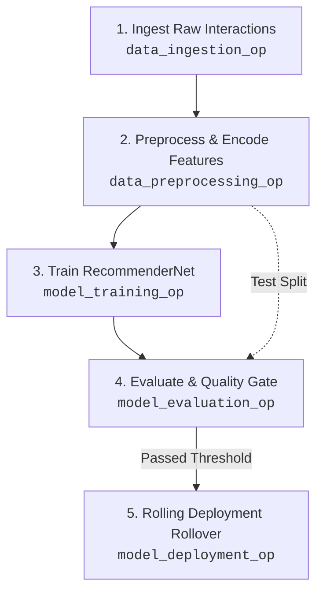

# Kubeflow Pipelines (KFP v2) for Hybrid Anime Recommender

This directory contains the production Kubeflow Pipelines v2 implementation for the **Hybrid Anime Recommender System**. It automates the machine learning lifecycle: data ingestion, preprocessing, Neural Collaborative Filtering model training, quality gating evaluation, and Kubernetes / KServe rolling deployment.

---

## 🏛️ Pipeline Architecture & DAG Flow



---

## 📁 Directory Structure

```
kubeflow/
├── components.py                  # Modular KFP v2 components (@dsl.component)
├── pipeline.py                    # Master DAG definition & compiler
├── run_pipeline.py                # CLI runner to trigger runs on remote/local KFP clusters
├── anime_training_pipeline.yaml   # Compiled KFP v2 execution specification
├── kserve_service.yaml            # KServe InferenceService serving manifest
└── README.md                      # Documentation & operational guide
```

---

## 🚀 Quickstart Guide

### 1. Compile the Pipeline Locally

To compile the pipeline into a standalone YAML manifest:

```bash
uv run python -m kubeflow.pipeline
```

Output generated: `kubeflow/anime_training_pipeline.yaml`.

---

### 2. Trigger Runs on a Kubeflow Cluster

Using the CLI runner:

```bash
# Compile and submit run to Kubeflow cluster
uv run python -m kubeflow.run_pipeline \
  --host "http://<KUBEFLOW_ENDPOINT>:8080" \
  --experiment "anime-recommender-experiments" \
  --epochs 10 \
  --batch-size 64 \
  --embedding-dim 128
```

Or just compile without submitting:
```bash
uv run python -m kubeflow.run_pipeline --compile-only
```

---

### 3. Upload via Kubeflow Pipelines Web UI

1. Open your Kubeflow Central Dashboard (`http://<kubeflow-host>`).
2. Navigate to **Pipelines** in the sidebar.
3. Click **Upload Pipeline** -> **Upload a file**.
4. Select `kubeflow/anime_training_pipeline.yaml`.
5. Create a run with custom parameters (`epochs`, `batch_size`, `gcs_bucket`).

---

### 4. Deploying via KServe on Kubeflow

To serve the model with autoscaling (0 to 5 pods) using KServe:

```bash
kubectl apply -f kubeflow/kserve_service.yaml
```

Check inference service status:
```bash
kubectl get inferenceservices anime-recommender-service
```
